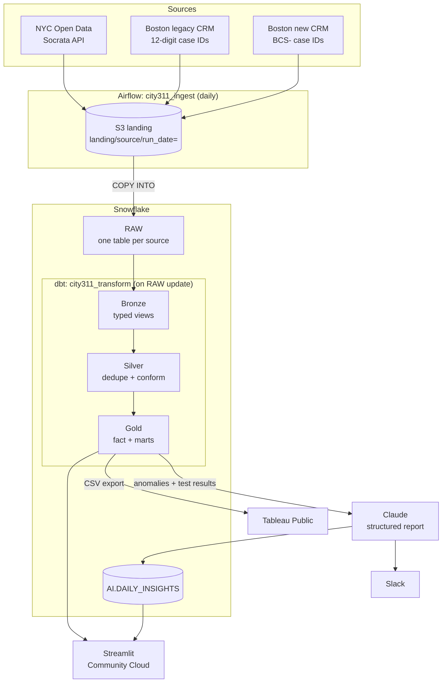

# City 311 Data Pipeline

Daily 311 service requests from **New York City** and **Boston**, ingested,
modeled and checked end to end, with an **AI layer that explains anomalies**
and a **live dashboard**.

**Stack:** Airflow 3 (Astro) · AWS S3 · Snowflake · dbt · Claude API · Streamlit · Tableau Public

> **Why it's interesting:** Boston is migrating 311 to a new CRM while this
> pipeline runs. Its data arrives from two systems with different schemas and ID
> formats, and volume shifts from one to the other a case type at a time. The
> pipeline reconciles both into one history, and the anomaly layer can tell a
> system migration from a real change in demand.

## Architecture



## How it works

| Layer | What happens | Where |
|---|---|---|
| **Ingest** | One parallel extract per source pulls records **created or closed** in a 3-day lookback window, so closures and late-published records are captured. Lands one JSON file per source per day in S3, then `COPY INTO` that source's RAW table. Re-runs overwrite the same key (idempotent). | `airflow/dags/city311_ingest.py`, `airflow/include/city311/sources.py` |
| **Bronze** | Raw JSON flattened to typed columns. Every loaded version is kept. | `dbt/models/bronze/` |
| **Silver** | Latest version of each request, then all three sources conformed to one schema: status groups, shared categories (seed), channels, cleaned ZIPs and coordinates, resolution hours, invalid-closure flag. | `dbt/models/silver/`, `dbt/seeds/` |
| **Gold** | `fct_service_requests` plus marts: daily volume, category performance (NYC vs Boston), open backlog, city KPIs, **volume anomalies** (z-score vs trailing 28 days, zero-filled days, at city / source-system / category level). | `dbt/models/gold/` |
| **AI insights** | SQL detects; Claude explains. The model sees only computed facts (flagged anomalies, KPIs, failed dbt tests, stale sources) and returns a schema-constrained JSON report. Findings that cite an anomaly the pipeline didn't flag are discarded. No anomalies means no model call. | `airflow/include/city311/insights.py` |
| **Dashboard** | Streamlit on Community Cloud reads GOLD live through a read-only role. Gold tables are also exported to CSV daily for a Tableau Public version. | `dashboard/`, `docs/deploy-dashboard.md` |

Orchestration is data-aware: `city311_ingest` updates the `city311_raw` asset,
which triggers `city311_transform` (source freshness, `dbt build`, AI report,
CSV export). The AI task runs even when `dbt build` fails, so failures get explained.

## Quality and testing

- **dbt:** 55 checks including unit tests (dedup keeps the latest version;
  status, ZIP, coordinate and on-time normalization), schema tests, and
  singular tests for domain rules: no request lost in dedup, Boston IDs match
  their system, invalid-closure rate, category-map coverage, source freshness.
- **Python:** unit tests for windowing, pagination, S3 keys, COPY SQL, the AI
  layer (structured-output request, hallucination guard, severity floor) and
  the exports. DAG structure tests run under real Airflow.
- **CI (GitHub Actions)** on every PR: gitleaks plus a project-specific
  secret scan, ruff, pytest, the full `dbt build` on DuckDB fixture data, an
  offline Snowflake compile parsed as Snowflake SQL, Airflow DAG integrity, a
  headless dashboard smoke test and the CSV export.

The same dbt models run on Snowflake (prod) and DuckDB (CI and demo) through a
handful of dispatching macros (`dbt/macros/cross_db.sql`).

## Setup

### 1. Configuration: no secrets in code

```bash
cp .env.example airflow/.env    # gitignored; fill in your values
```

Every credential and environment-specific value is read from environment
variables. Key files stay in `~/.aws` and `~/.snowflake` and are mounted
read-only into the containers.

### 2. Snowflake and AWS

Run the scripts in `snowflake/` in order, replacing `<PLACEHOLDERS>`:

| Script | Creates |
|---|---|
| `01_setup.sql` | warehouse, database, RAW schema |
| `02_integration.sql` | S3 storage integration (IAM role + external ID: `infra/aws/*.template.json`) |
| `03_stage_and_load.sql` | external stage + JSON file format |
| `04_airflow_service_user.sql` | `PIPELINE_LOADER` role + key-pair user `AIRFLOW_SVC` |
| `05_multi_source_raw.sql` | one RAW table per source (renames the original NYC table) |
| `06_dbt_transformer.sql` | `TRANSFORMER` role for dbt |
| `07_ai_insights.sql` | `AI.DAILY_INSIGHTS` |
| `08_reporting_access.sql` | read-only `REPORTER` role + `STREAMLIT_SVC` user for the dashboard |

### 3. Run Airflow

```bash
cd airflow && astro dev start      # UI at http://localhost:8080
```

Unpause `city311_ingest`; `city311_transform` follows automatically.

### 4. Dashboard

See [docs/deploy-dashboard.md](docs/deploy-dashboard.md) for Streamlit Community
Cloud and Tableau Public.

## Run it without Snowflake

The whole transform, AI and dashboard path runs locally on DuckDB fixture data
that mimics the real feeds, including the Boston migration, an outage and a
noise spike:

```bash
pip install -r requirements-dev.txt -r dashboard/requirements.txt
python scripts/ci/load_fixtures.py dbt/target/city311_ci.duckdb
(cd dbt && DBT_PROFILES_DIR=. dbt build --target ci)
python scripts/run_insights_local.py          # prints the AI context; calls Claude if ANTHROPIC_API_KEY is set
streamlit run dashboard/app.py                # demo mode
```

## Repository layout

```
airflow/            Astro project: DAGs, include/city311 (sources, insights, exports), tests
dbt/                bronze / silver / gold models, seeds, macros, tests
dashboard/          Streamlit app (Snowflake live or DuckDB demo)
snowflake/          numbered, idempotent setup scripts
infra/aws/          IAM policy templates
scripts/            fixtures, CI checks, CSV export, local AI run
docs/               dashboard deployment (Streamlit, Tableau)
```

## Design decisions

- **Created-or-closed extraction with lookback.** Extracting by creation date alone never captures closures, so resolution times would be wrong.
- **One RAW table per source.** Each feed is stored exactly as received; schema reconciliation happens once, in silver.
- **Deterministic detection, AI explanation.** Anomalies are reproducible SQL; the LLM adds context but can't invent incidents, and runs only when there is something to explain.
- **Least-privilege roles.** Loader, transformer and reporter are separate, and the public dashboard can read GOLD only.
- **dbt Core 1.12**, not Fusion, so the same project can also run on DuckDB in CI.

Data: [NYC Open Data, 311 Service Requests](https://data.cityofnewyork.us/Social-Services/311-Service-Requests-from-2010-to-Present/erm2-nwe9) ·
[Analyze Boston, 311 Service Requests](https://data.boston.gov/dataset/311-service-requests)
